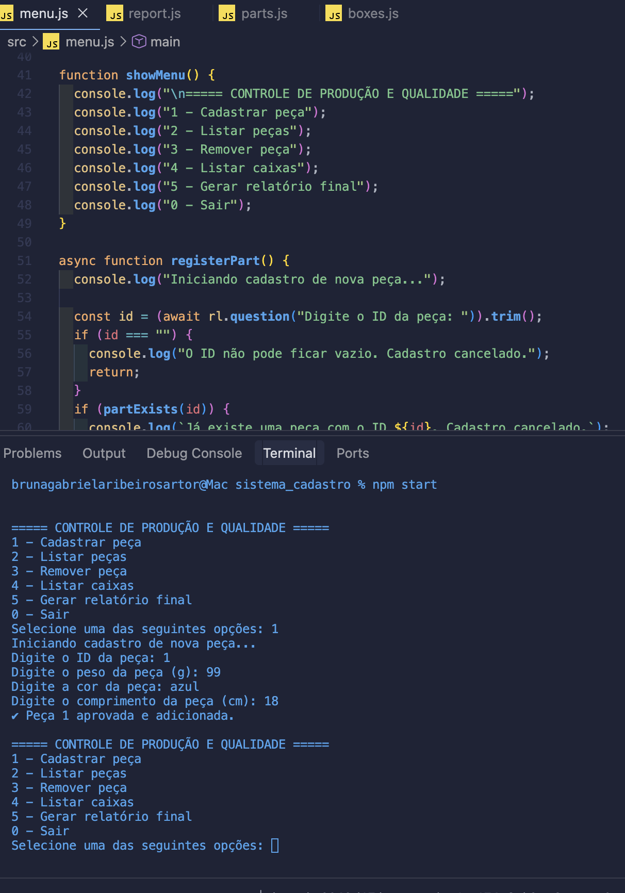

# 🏭 Sistema de Controle de Produção e Qualidade de Peças

<p align="center">

Sistema em **JavaScript (Node.js)** para controle de qualidade e empacotamento de peças em uma linha de montagem industrial.

Reescrita em JavaScript de um protótipo desenvolvido originalmente em Python para a disciplina **Algoritmos e Lógica de Programação**</br>
**UniFECAF/Rocketseat · Inteligência Artificial e Automação Digital**

---

## 📋 Sobre o Projeto

Este sistema simula o controle de qualidade de uma linha de produção industrial. Ele automatiza o controle de produção, a inspeção de qualidade e o armazenamento de peças, substituindo um processo que, feito manualmente, seria suscetível a erros e inconsistências.

O comportamento do programa é o mesmo da versão em Python; muda a linguagem e a organização do código, que foi dividido em módulos para separar as regras de negócio da interação com o usuário.

### Funcionalidades

* **Cadastrar peça**: registra uma peça com ID, peso, cor e comprimento, validando automaticamente se ela atende aos critérios de qualidade.
* **Listar peças**: exibe todas as peças cadastradas com status (Aprovada/Reprovada) e detalhes das falhas encontradas.
* **Remover peça**: remove uma peça pelo ID e reorganiza as caixas automaticamente.
* **Listar caixas**: exibe as caixas já fechadas com suas respectivas peças e a situação da caixa atual.
* **Gerar relatório final**: exibe totais de peças aprovadas, reprovadas, caixas utilizadas e motivos de reprovação.

---

## 📝 Como funciona

O sistema opera via terminal (linha de comando) através de um menu interativo. Ele recebe os dados de cada peça fabricada e avalia automaticamente se ela está aprovada ou reprovada com base em critérios de qualidade.

### Critérios de Qualidade

| Atributo | Valor aceito |
| :--- | :--- |
| **Peso** | 95g a 105g |
| **Cor** | azul ou verde |
| **Comprimento** | 10cm a 20cm |

### Empacotamento

* Peças aprovadas são alocadas automaticamente à caixa atual. Cada caixa comporta no máximo **10 peças**.
* Quando a capacidade é atingida, a caixa é fechada e uma nova é iniciada.
* Peças que não atendem a um ou mais critérios são marcadas como **Reprovadas** e não são adicionadas às caixas.
* Ao remover uma peça, todas as caixas são reorganizadas.

---

## ✅ Requisitos

### Requisitos Funcionais

Descrevem **o que** o sistema faz.

**RF01: Exibir menu principal**
O sistema deve exibir um menu no terminal com as opções disponíveis e aguardar a escolha do usuário. Após executar cada opção, o menu deve ser exibido novamente, até que o usuário escolha sair.

**RF02: Cadastrar peça**
O sistema deve solicitar ao usuário o ID, o peso (em gramas), a cor e o comprimento (em centímetros) da peça, e registrá-la na lista de peças cadastradas.

**RF03: Validar a qualidade da peça**
No momento do cadastro, o sistema deve verificar automaticamente se a peça atende aos critérios de qualidade (peso, cor e comprimento) e classificá-la como **Aprovada** ou **Reprovada**. Em caso de reprovação, o sistema deve registrar e exibir todos os motivos.

**RF04: Armazenar peças aprovadas em caixas**
O sistema deve adicionar automaticamente cada peça aprovada à caixa atual. Quando a caixa atingir 10 peças, ela deve ser fechada e uma nova caixa deve ser iniciada. Peças reprovadas não são armazenadas em caixas.

**RF05: Listar peças**
O sistema deve exibir todas as peças cadastradas, com ID, status (Aprovada/Reprovada), medidas e, quando houver, as falhas encontradas.

**RF06: Remover peça**
O sistema deve permitir remover uma peça informando o seu ID. Após a remoção, as caixas devem ser reorganizadas automaticamente. Se o ID não existir, o sistema deve informar que a peça não foi encontrada.

**RF07: Listar caixas**
O sistema deve exibir as caixas já fechadas, com as respectivas peças, e a situação da caixa atual (em aberto).

**RF08: Gerar relatório final**
O sistema deve exibir um relatório com: total de peças cadastradas, total de aprovadas, total de reprovadas, total de caixas utilizadas (fechadas e em uso) e a quantidade de ocorrências de cada tipo de motivo de reprovação.

**RF09: Encerrar o sistema**
O sistema deve permitir que o usuário encerre o programa por meio de uma opção do menu.

**RF10: Tratar entradas inválidas**
O sistema deve informar o usuário, sem encerrar o programa, quando for digitada uma opção inexistente no menu ou um valor não numérico nos campos de peso e comprimento.

### Requisitos Não Funcionais

Descrevem **como** o sistema funciona: suas qualidades e restrições.

**RNF01: Plataforma**
O sistema deve ser executado no terminal (linha de comando), utilizando Node.js em versão LTS (20 ou superior).

**RNF02: Linguagem e dependências**
O sistema foi ser desenvolvido em JavaScript, utilizando apenas os recursos nativos do Node.js, sem bibliotecas externas.

**RNF03: Armazenamento dos dados**
Nesta versão, os dados são mantidos apenas em memória durante a execução. Ao encerrar o programa, os dados são perdidos.

**RNF04: Usabilidade**
As mensagens são exibidas em português, de forma clara e objetiva, indicando o resultado de cada operação (sucesso, reprovação ou erro).

**RNF05: Organização do código**
O desenvolvimento foi feito em duas etapas:
1. **Versão base:** todo o código em um único arquivo (`script.js`), com foco em reproduzir a lógica do sistema original.
2. **Refatoração:** divisão do código em arquivos separados, isolando a lógica de negócio (validação, caixas e relatório) da interação com o usuário (menu, leitura do teclado e exibição de mensagens), para permitir a evolução futura do sistema para API e front-end sem reescrever as regras.

**RNF06: Manutenibilidade**
Os valores dos critérios de qualidade (peso mínimo e máximo, cores válidas, comprimento mínimo e máximo, capacidade da caixa) devem ser definidos como constantes em um único local, para facilitar alterações.

**RNF07: Portabilidade**
O sistema deve funcionar em Windows, macOS e Linux, sem necessidade de adaptação.

---

## 📌 Exemplos de Entradas e Saídas

### Exemplo 1: Cadastrando uma peça aprovada

**Entrada**

```
Selecione uma das seguintes opções: 1
Iniciando cadastro de nova peça...
Digite o ID da peça: 1
Digite o peso da peça (g): 100
Digite a cor da peça: azul
Digite o comprimento da peça (cm): 15
```

**Saída**

```
✔ Peça 1 aprovada e adicionada.
```

### Exemplo 2: Cadastrando uma peça reprovada

**Entrada**

```
Selecione uma das seguintes opções: 1
Iniciando cadastro de nova peça...
Digite o ID da peça: 2
Digite o peso da peça (g): 90
Digite a cor da peça: vermelho
Digite o comprimento da peça (cm): 15
```

**Saída**

```
✘ ATENÇÃO! Peça 2 não passou no teste de qualidade.
Nem todos os requisitos de qualidade foram alcançados:
- Peso fora do padrão (90.0g)
- Cor inválida (vermelho)
```

### Exemplo 3: Listando peças

**Entrada**

```
Selecione uma das seguintes opções: 2
```

**Saída**

```
ID: 1 | Status: Aprovada
Medidas: 100.0g, Azul, 15.0cm
ID: 2 | Status: Reprovada
Medidas: 90.0g, Vermelho, 15.0cm
  Falhas encontradas: Peso fora do padrão (90.0g), Cor inválida (vermelho)
```

### Exemplo 4: Gerando relatório

**Entrada**

```
Selecione uma das seguintes opções: 5
```

**Saída**

```
RELATÓRIO FINAL:
Total de peças cadastradas: 2
✔ Total de peças aprovadas: 1
✘ Total de peças reprovadas: 1
📦 Total de caixas utilizadas (fechadas e em uso): 1
Os motivos para reprovação registrados são:
Peso fora do padrão: 1 vez(es)
Cor inválida: 1 vez(es)
```

> No relatório, os motivos são agrupados por tipo, sem considerar o valor medido. Os valores de cada peça estão disponíveis na opção 2 (Listar peças).

### Exemplo 5: Removendo uma peça

**Entrada**

```
Selecione uma das seguintes opções: 3
Digite o ID da peça que você deseja remover: 2
```

**Saída**

```
Peça ID 2 removida com sucesso!
Caixas reorganizadas após a remoção da peça 2.
```

### Exemplo 6: Entrada inválida

**Entrada**

```
Digite o peso da peça (g): abc
```

**Saída**

```
Valor inválido. Digite um número.
Digite o peso da peça (g):
```

---

## 🚀 Como Rodar o Programa

### Pré-requisitos

[Node.js](https://nodejs.org/) versão 20 ou superior instalado.

Para verificar a versão instalada:

```bash
node --version
```

### Passo a passo

1. Clone este repositório:
   ```bash
   git clone https://github.com/brugaby2342/sistema_cadastro.git
   ```
2. Entre na pasta do projeto:
   ```bash
   cd sistema_cadastro
   ```
3. Execute o programa:
   ```bash
   npm start
   ```

Não é necessário rodar `npm install`: o projeto não usa bibliotecas externas.

---

## 🏗 Estrutura do Projeto

```
sistema_cadastro/
├── package.json
├── README.md
├── arquitetura.md   # planejamento antes do desenvolvimento do projeto
└── src/
    ├── main.js     # ponto de entrada do programa
    ├── menu.js      # interação com o usuário (menu, teclado e mensagens)
    ├── config.js    # constantes: critérios de qualidade e capacidade da caixa
    ├── parts.js     # regras de negócio das peças
    ├── boxes.js     # regras de negócio das caixas
    └── report.js    # cálculo do relatório
```

* **Somente o `menu.js`** exibe mensagens (`console.log`) e lê o teclado.
* Os arquivos de regras de negócio **recebem dados e retornam dados**, sem imprimir nada.
* Com isso, a interface de terminal pode ser substituída no futuro por uma API ou uma página web, sem reescrever as regras.

### Modelo de dados: peça

```js
{
  id: "1",
  weight: 100,          // gramas
  color: "azul",
  length: 15,           // centímetros
  reasons: [],          // motivos de reprovação; vazio se aprovada
  status: "Aprovada"    // "Aprovada" ou "Reprovada"
}
```
---

## 🛠️ Tecnologias e Conceitos Aplicados

**JavaScript / Node.js**: sem bibliotecas externas.

**Módulos (ES Modules)**: `import`/`export` para dividir o código em arquivos com responsabilidades separadas.

**Estrutura de dados:**</br>
*Arrays*: armazenamento de peças e caixas.</br>
*Objetos*: representação de cada peça e do relatório.</br>
*Set*: `VALID_COLORS`, para verificação eficiente de pertencimento.

**Boas práticas:**</br>
Constantes centralizadas em `config.js`.</br>
Separação entre regras de negócio e interface.</br>
Validação de entradas (números, ID vazio, ID duplicado, opção inválida).</br>
Template strings para formatação de mensagens.

---

## 🔮 Próximos Passos

* Persistir os dados em arquivo JSON.
* Criar uma API para expor as regras de negócio.
* Desenvolver uma interface web.
* Integrar um banco de dados.

---

## 📝 Licença e Uso

Este projeto está sob a **Licença ISC**
Uso livre para estudo e referência.

Feito por Bruna Gabriela Ribeiro Sartor</br>